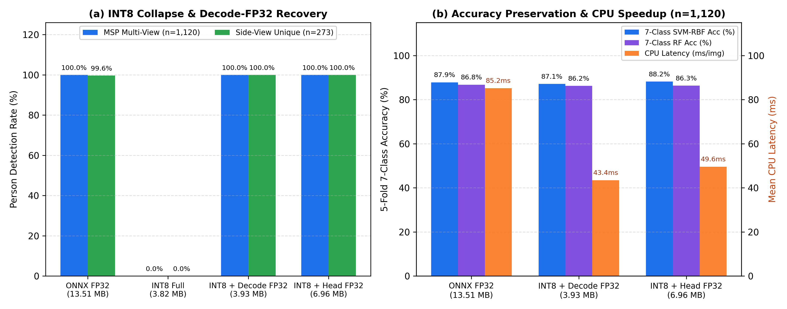
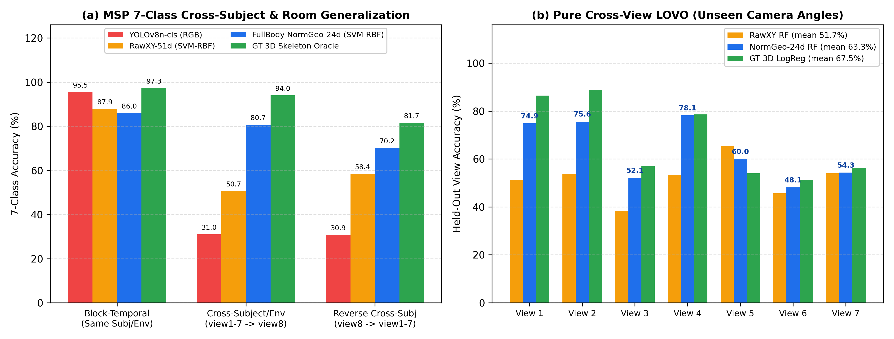
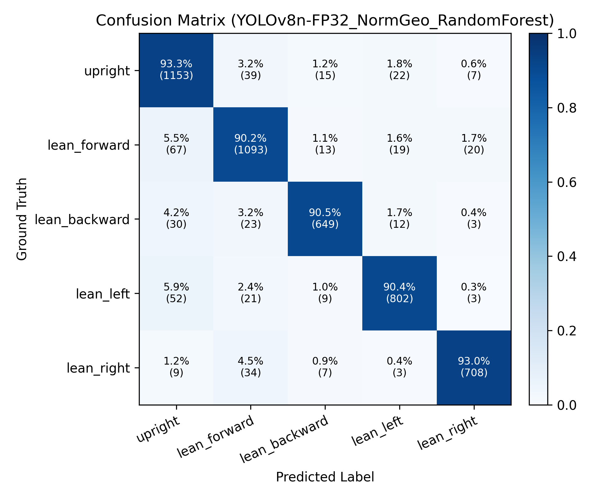

# EdgePosture: Edge-Collaborative Sitting Posture Monitoring & Voice Feedback System

**Project Origin**: 9th National College Integrated Circuit Innovation & Entrepreneurship Competition (CICC 2025, Sophgo Cup) — **National Third Prize & South China Regional First Prize** (Team: Xiaoxiaobei, Shenzhen MSU-BIT University).

## Overview

EdgePosture is a low-cost, privacy-preserving sitting posture monitoring and voice correction system built on heterogeneous edge hardware:

- **Front-End Perception**: Sipeed **MaixCAM** (RISC-V SG2002) mounted on a custom 3D-printed 2-DOF dual-SG90 servo gimbal for image capture / face tracking.
- **Edge AI Inference Server**: Sophgo **SOPHON AirBox** (BM1684X TPU) executing quantized `YOLOv8-Pose` (`BModel`) inference locally via `sophon-sail` and `BMCV` / `OpenCV` pipelines without uploading raw video frames to the cloud.
- **Posture Analysis & Multimodal Feedback**: A Flask-based posture evaluation service computing 17-keypoint neck/torso geometry, generating personalized posture advice (Baidu Wenxin API with local deterministic fallback), displaying live metrics on a web dashboard, and broadcasting audio reminders over a LAN IP speaker.

## System Architecture

```text
+-------------------+       HTTP / SCP / RTSP        +----------------------------+
|  Sipeed MaixCAM   | -----------------------------> |   SOPHON AirBox (BM1684X)  |
|  (SG2002 + SG90   |                                |  YOLOv8-Pose BModel (SAIL) |
|   2-DOF Gimbal)   |                                |  -> 17 Keypoints JSON      |
+-------------------+                                +----------------------------+
                                                                   |
                                                                   v  JSON Keypoints
+-------------------+         LAN HTTP TTS           +----------------------------+
|   LAN IP Speaker  | <----------------------------- |   Flask Analysis Backend   |
|  (Voice Alerts)   |                                |  - Angle & Baseline Check  |
+-------------------+                                |  - Web UI (/advice)        |
                                                     |  - LLM Advice + Fallback   |
                                                     +----------------------------+
```

## Repository Structure

```text
EdgePosture-AirBox-MaixCam/
├── backend/                  # Posture evaluation server, web UI, LLM & TTS integration
│   ├── app.py                # Flask server (RTSP stream + /detect_keypoints + /advice UI)
│   ├── anomaly_detector.py   # Baseline deviation & angle-threshold posture classifier
│   ├── pose_estimator.py     # Ultralytics YOLOv8-Pose wrapper (host fallback/dev)
│   ├── yolo_detector.py      # Person bounding-box pre-detector with gamma correction
│   ├── speaker/
│   │   └── ip_speaker.py     # GB2312-Base64 HTTP TTS client for LAN IP speaker
│   └── static/               # Web dashboard (advice.html, rtsp-manager.js, styles.css)
├── edge_inference/           # SOPHON BM1684X deployment (Python & C++ BMCV pipelines)
│   ├── python/
│   │   ├── yolov8_opencv.py  # Multi-threaded image decode + SAIL BModel inference
│   │   ├── yolov8_bmcv.py    # Hardware JPU decode + BMCV preprocess pipeline
│   │   └── utils.py
│   ├── cpp/                  # Native C++ BMCV + FFmpeg inference implementation
│   ├── docs/                 # ONNX export guide for TPU-MLIR compilation
│   └── tools/                # COCO keypoint evaluation & benchmark comparison tools
├── hardware/                 # 3D CAD models (.step, .stl, SolidWorks parts)
│   ├── README.md
│   └── cad_parts/
├── experiments/              # Quantization diagnosis, multi-view MSP & 4090 ablations
│   ├── README.md
│   ├── outputs/              # Verified JSON summaries & 300-DPI ablation figures
│   └── *.py                  # Reproducible benchmark, quantization & training scripts
├── .env.example
├── .gitignore
├── requirements.txt
└── LICENSE
```

## Quick Start

### 1. Backend & Web Dashboard (Host / Edge Gateway)

```bash
pip install -r requirements.txt
cp .env.example .env
# Edit .env to configure BAIDU_API_KEY, BAIDU_SECRET_KEY, RTSP_URL, and IP_SPEAKER_HOST
```

Run the Flask server:

```bash
cd backend
python app.py
```

Open `http://localhost:5000/advice` in your browser to view live posture status, neck/body angles, and posture feedback.

### 2. SOPHON AirBox (BM1684X) Edge Inference

On the AirBox (Ubuntu 20.04 LTS with Sophon SDK 23.09 LTS SP4 installed):

```bash
cd edge_inference/python
python3 yolov8_opencv.py \
  --input ../datasets/test \
  --bmodel ../models/BM1684X/yolov8n_pose_1684x_f32.bmodel \
  --dev_id 0 \
  --conf_thresh 0.25 \
  --nms_thresh 0.7
```

To benchmark `BModel` latency directly on the BM1684X TPU:

```bash
bmrt_test --bmodel /path/to/yolov8n_pose_1684x_f32.bmodel
bmrt_test --bmodel /path/to/yolov8n_pose_1684x_int8_sym.bmodel
```

See [edge_inference/docs/YOLOv8_Export_Guide.md](edge_inference/docs/YOLOv8_Export_Guide.md) and [edge_inference/cpp/README.md](edge_inference/cpp/README.md) for ONNX export, TPU-MLIR compilation, and C++ BMCV build instructions.

## Measured Hardware Benchmarks (BM1684X)

Observed `bmrt_test` TPU kernel measurements on our AirBox unit (`yolov8n_pose`, input `1x3x640x640`):

| Model Precision | Model Size | NPU Launch Total Time | `calculate` Time | Notes |
| :--- | :--- | :--- | :--- | :--- |
| `yolov8n_pose_1684x_f32.bmodel` | 16 MB | 13.34 ms | 13.34 ms | Reliable keypoint detection on test images |
| `yolov8n_pose_1684x_int8_sym.bmodel` | 6.3 MB | 2.23 ms | 2.24 ms | 6x faster kernel, but symmetric INT8 requires mixed-precision decode FP32 (diagnosed below) |

## Experimental Validation & Ablations

To systematically diagnose the INT8 recall collapse observed during edge deployment and evaluate posture classification beyond single-room splits, we provide a full reproducible benchmark suite in [`experiments/`](experiments/README.md) covering three public/multi-view datasets (**4,813** front-view desktop frames, **273** deduplicated side-view spine-keypoint frames, and **5,600** uniformly subsampled frames from the 49,798-frame 8-view 7-class **MSP** sitting posture corpus).

### 1. INT8 Quantization Collapse Diagnosis & Mixed-Precision Recovery

Static full-graph ONNX INT8 quantization (`3.82 MB`) reproduces the exact `0.0%` detection failure seen on symmetric INT8 compilation. Isolating only the 72 post-convolution decode/DFL/Sigmoid operators inside `/model.22/` in FP32 (`Mixed_DecodeFP32`, `3.93 MB`) restores full detection with a `-70.9%` footprint reduction and nearly `2x` CPU speedup on multi-view full-body frames (`n=1,120`):

| ONNX Variant (`yolov8n-pose`) | Size | Side-273 Det / `PCK@0.15` | MSP-1,120 Det | MSP CPU Latency | MSP `PCK@0.10` vs FP32 | Downstream 7-Class Acc (SVM / RF) |
| :--- | :---: | :---: | :---: | :---: | :---: | :---: |
| `ONNX_FP32` | 13.51 MB | 99.63% / 80.02% | 100.0% | 85.21 ms | Baseline | 87.86% / 86.79% |
| `ONNX_INT8_Full` | 3.82 MB | **0.0% / 0.0%** | **0.0%** | 28.08 ms | 0.0% | Failed |
| `ONNX_INT8_Mixed_DecodeFP32` | **3.93 MB** | **100.0% / 81.27%** | **100.0%** | **43.44 ms** | **97.73%** | **87.14% / 86.25%** |
| `ONNX_INT8_Mixed_HeadFP32` | 6.96 MB | 100.0% / 81.62% | 100.0% | 49.59 ms | 99.03% | 88.21% / 86.34% |



### 2. Cross-Subject & Cross-View Posture Generalization (`MSP` 5,600 Frames, 7 Classes)

While end-to-end RGB classification (`YOLOv8n-cls`, RTX 4090) scores `95.45%` within the same subject/environment (`Block-Temporal`), it collapses to **`31.00%`** on an unseen subject and hallway environment (`view1-7 -> view8`). Our 24-dim torso- & view-normalized geometric representation (`FullBody_NormGeo`) raises unseen subject/environment accuracy to **`80.71%`** (`SVM-RBF`, Macro-F1 `80.83%`):

| Evaluation Protocol | `YOLOv8n-cls` (RGB, 4090) | `RawXY` (51-dim) | `FullBody_NormGeo` (24-dim) | 3D GT `Hkeypoints` Oracle |
| :--- | :---: | :---: | :---: | :---: |
| Block-Temporal (`3,360 -> 1,120`, 20% gap) | **95.45%** | 88.84% (MLP) | 85.98% (SVM-RBF) | 97.32% (SVM-RBF) |
| Cross-Subject & Room (`view1-7 -> view8`) | 31.00% | 50.71% (SVM) / 56.14% (MLP) | **80.71%** (SVM-RBF) | 94.00% (SVM-RBF) |
| Reverse Cross-Subject (`view8 -> view1-7`) | 30.86% | 58.41% (SVM) | **70.22%** (SVM-RBF) | 81.65% (SVM-RBF) |
| Pure Cross-View LOVO (`view1..7` unseen angle) | `view3`: 54.86% / `view7`: 62.29% | 51.67% (RF) | **63.31%** (RF) | 67.45% (LogReg) |

- **Desktop Front/Side Benchmarks**: On `front_view_classification` (4,813 frames, 5 classes), `NormGeo + RandomForest` reaches **`91.52% ± 0.42%`** 5-fold CV accuracy (`vs. 74.32%` legacy threshold baseline with `0.0%` upright recall). On `side_view_keypoints` (273 deduplicated frames), 4090 fine-tuned `YOLOv8n-pose` achieves **`0.9906` pose mAP@50** and `86.39%` 5-fold `Good`/`Bad` accuracy.
- **Open Research Boundary**: Under pure Leave-One-View-Out testing on unseen camera azimuths (`view3` 90° side = `52.14%`, `view6` = `48.14%`), single-frame 2D projections remain ambiguous between forward trunk flexion and lateral camera viewing angle (matching the drop seen even with unaligned 3D skeletons), motivating future camera-azimuth canonicalization or temporal filtering.



<details>
<summary>Additional Figure: Front-View 5-Class Confusion Matrix (91.52% 5-Fold CV)</summary>



</details>

## Hardware BOM (Prototype)

| Component | Qty | Approx. Cost (CNY) |
| :--- | :---: | :---: |
| Radxa / SOPHON Fogwise AirBox (BM1684X) | 1 | 2699 |
| Sipeed MaixCAM RISC-V Dev Board (with 32GB SD) | 1 | 320 |
| SG90 Micro Servos | 2 | 10 |
| 3D-Printed PETG Desk Clamp & PLA/PETG Gimbal | 1 set | ~10 |

## Team & Acknowledgments

- **Team**: HAN Yun, DONG Jie, ZHANG Chengzhen (Shenzhen MSU-BIT University)
- **Advisors**: DONG Yanjie, WANG Wei, ZHENG Jianbo
- Built upon [Sophgo SOPHON-DEMO](https://github.com/sophgo/sophon-demo) (`2-Clause BSD`) and [Ultralytics YOLOv8](https://github.com/ultralytics/ultralytics).
